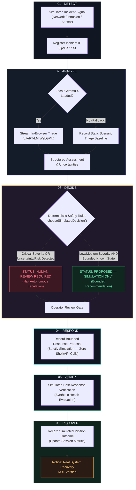

# Queen AI 👑
### *Local intelligence. Guarded autonomy. Verified resilience.*

[](server.py)
[-4285F4?logo=google&logoColor=white)](https://cdn.jsdelivr.net/npm/@litert-lm/core/+esm)
[-8E75B2)](https://ai.google.dev/gemma)
[](index.html)
[-FFC875)](index.html)
[](#license-and-acknowledgments)

> **Queen AI** is a local-first autonomous incident triage and resilience simulation platform that pairs in-browser **Gemma 4** intelligence via **LiteRT-LM** with deterministic safety guardrails to evaluate infrastructure anomalies without cloud data egress or reckless automated execution.

[Architecture](#six-stage-architecture) • [Quick Start](#quick-start) • [Safety Model](#safety-and-responsible-autonomy) • [Testing & Validation](#testing-and-validation) • [Roadmap](#roadmap)

---

## The Problem

Modern site reliability and security operations face an acute operational dilemma: **incidents require rapid, contextual analysis, but deploying autonomous AI agents directly to production infrastructure introduces severe risks.**

1. **Telemetry Egress & Data Privacy Risks**  
   Incident logs, system metrics, and network traces contain proprietary topologies, credentials, IP addresses, and customer data. Broadcasting raw incident streams to third-party cloud LLM APIs introduces data sovereignty violations, regulatory exposure, and recurrent API latency and cost.
2. **The "Black-Box" Automation Hazard**  
   Generative AI models can hallucinate root causes or project unwarranted confidence when faced with incomplete telemetry. Without deterministic checks, an agent granted write or execution permissions can turn a transient glitch into a catastrophic cascade (e.g., isolating production clusters or rebooting healthy datastores).
3. **Operator Distrust and Alert Fatigue**  
   Engineers reject autonomous tools that do not provide clear rationale or that obscure decision paths. Unbounded autonomy without explicit human approval gates breeds operational skepticism.

**Queen AI addresses this challenge directly:** rather than granting an opaque model direct shell access, Queen AI brings lightweight, local Gemma 4 reasoning into an isolated browser environment, surrounds it with deterministic safety bounds, and confines all response proposals to verifiable simulations.

---

## The Solution

Queen AI implements a **local-first incident triage and resilience simulation architecture** designed to demonstrate how autonomous incident response can remain private, deterministic, and safe.

* **100% In-Browser Local Inference:** Gemma 4 models (`.litertlm`) run locally inside the operator's browser leveraging WebGPU and WebAssembly threads via LiteRT-LM. Incident telemetry never leaves the host machine.
* **Guarded 6-Stage Mission Pipeline:** Autonomous triage moves through six discrete lifecycle stages: *Detect*, *Analyze*, *Decide*, *Respond*, *Verify*, and *Recover*.
* **Deterministic Safety Gating:** Machine learning is strictly advisory. A hard-coded deterministic policy evaluator inspects the triage text and declared severity. If uncertainty or critical risk is detected, the system forces a `HUMAN REVIEW REQUIRED` gate.
* **Simulation-Bounded Execution:** Response proposals are strictly sandboxed. The application records bounded operational proposals (such as *"No-op / observe and verify"*) without touching live infrastructure, shells, or external APIs.
* **Live Session Audit Trail:** Every pipeline state transition, model inference chunk, and decision rationale is logged to an in-memory and local browser audit store, exportable as structured JSON.

| Capability | Current Prototype Status | Production / Roadmap Direction |
| :--- | :--- | :--- |
| **Model Inference** | **Implemented:** Local in-browser via LiteRT-LM & WebGPU | Hybrid local edge worker / dedicated container |
| **Telemetry Ingestion** | **Simulated:** Preset scenarios (Network, Intrusion, Sensor) | Read-only OpenTelemetry / Prometheus streaming |
| **Triage Generation** | **Implemented:** Streaming Gemma 4 structured prompts | Multi-model consensus and confidence scoring |
| **Safety Gating** | **Implemented:** Deterministic regex & severity heuristics | Formal policy engine (Rego / OPA) & signatures |
| **Action Execution** | **Simulation Only:** Zero shell/network execution | Operator-confirmed webhooks with rollback plans |
| **Recovery Check** | **Simulation Only:** Synthetic verification criteria | Live telemetry delta checks & canary monitoring |
| **Audit Storage** | **Implemented:** Browser `localStorage` (max 500 events) | Immutable append-only remote ledger / S3 audit |

---

## Visual Demo

### Command Center Dashboard

> *Below is the target visual layout of the Queen AI Command Center running at `http://127.0.0.1:8787`.*

```
┌────────────────────────────────────────────────────────────────────────────────────────────────────────┐
│  [Q] QUEEN AI   AUTONOMOUS OPERATIONS PLATFORM                     [● SYSTEM STANDBY / ACTIVE]         │
│      Local intelligence · Resilience · Verified response                                               │
├────────────────────────────────────────────────────────────────────────────────────────────────────────┤
│  MISSION STATUS           THREAT SEVERITY             MISSIONS COMPLETED          RECOVERY VERIFIED    │
│  [ READY / ACTIVE ]       [ HIGH / CRITICAL ]         [ 3 in session ]            [ SIMULATED ]        │
├───────────────────────────────────────────────────────┬────────────────────────────────────────────────┤
│  AUTONOMOUS MISSION PIPELINE             [STAGE 2/6]  │  LIVE EVENT STREAM               [14 EVENTS]   │
│  ┌────┐   ┌────┐   ┌────┐   ┌────┐   ┌────┐   ┌────┐   │  11:42:01 [●] Gemma 4 triage attached          │
│  │ 01 │ > │ 02 │ > │ 03 │ > │ 04 │ > │ 05 │ > │ 06 │   │  11:42:00 [●] Local inference streaming...    │
│  └────┘   └────┘   └────┘   └────┘   └────┘   └────┘   │  11:41:58 [●] Detect: Signal registered        │
│  Detect  Analyze  Decide   Respond  Verify   Recover   │  11:41:50 [●] Command center initialized       │
│                                                       ├────────────────────────────────────────────────┤
│  SCENARIO CONTROLS                                    │  SAFETY & AUTONOMY                 [GUARDED]   │
│  Scenario: [ Network service outage        ▼ ]        │  • Action Execution: SIMULATION ONLY           │
│  Asset:    [ edge-node-07                  ]          │  • Human Oversight:  ENABLED                   │
│  Severity: [ High                          ▼ ]        │  • Audit Trail:      ACTIVE (Browser-side)     │
│  [ Execute controlled response ]                      ├────────────────────────────────────────────────┤
│                                                       │  SESSION AUDIT                                 │
│  LOCAL GEMMA 4 INTELLIGENCE              [LOADED]     │  [ Export event log (JSON) ]                   │
│  Model: [ gemma-4-E2B-it-web.litertlm      ]          │                                                │
│  [ Load local Gemma 4 ]  [ Test inference ]           │                                                │
│  Model Output: "Initial assessment: Node connectivity │                                                │
│  degradation... Uncertainty: telemetry incomplete..." │                                                │
└───────────────────────────────────────────────────────┴────────────────────────────────────────────────┘
```

> [!NOTE]
> **Dashboard Screenshot Capture Instruction:**
> To capture and add a real high-resolution screenshot to this repository:
> 1. Start Queen AI using `python server.py`.
> 2. Open `http://127.0.0.1:8787` in a 1920×1080 browser window.
> 3. Trigger a simulation run, capture the screen, and save the image to `docs/assets/dashboard.png`.
> 4. Reference it in markdown using ``.

### 5-Step Demo Walkthrough

1. **Select an Incident Scenario:** Choose from *Network service outage*, *Suspicious access detected*, or *Critical sensor anomaly*, and specify the affected target asset (e.g., `edge-node-07`).
2. **Load Compatible Local Gemma 4 Model:** Select your downloaded `.litertlm` file via the file picker and click **Load local Gemma 4** to initialize the LiteRT-LM runtime in browser memory. *(The simulation can also run independently in model-free demo mode).*
3. **Execute Controlled Response:** Click **Execute controlled response** or **Run incident simulation** to launch the mission pipeline.
4. **Observe Streaming Triage & Safety Gate:** Watch Gemma 4 stream structured reasoning in real time during the `Analyze` stage. The `Decide` stage immediately evaluates the text against safety heuristics to check whether human intervention is mandated.
5. **Review Audit Trail & Export Evidence:** Inspect stage transitions and rationale in the Live Event Stream, then click **Export event log** to download a verifiable JSON session record.

---

## Six-Stage Architecture

Queen AI structures autonomous operations into a linear, guarded state machine where non-deterministic AI generation is strictly separated from deterministic control flow.



### Stage Details

1. **Detect (`Stage 01`):**  
   Registers telemetry inputs (asset identifier, initial severity, incident profile). Assigns a unique mission ID (`QAI-<TIMESTAMP_BASE36>`), resets mission metrics, and writes an acceptance event to the audit trail.
2. **Analyze (`Stage 02`):**  
   If a local Gemma 4 model is loaded, prompts the model with a disciplined incident prompt demanding:
   - Initial assessment
   - Identified uncertainties
   - One bounded, reversible simulation proposal
   - Verification criteria
   - Explicit safety cautions  
   The model streams tokens directly into the UI. If no model is loaded, the pipeline falls back gracefully to synthetic baseline triage without interrupting the workflow.
3. **Decide (`Stage 03`):**  
   Executes deterministic safety heuristics (`chooseSimulatedDecision`). Inspects the analysis text and declared severity for flags indicating high risk (`Critical`, `intrusion`, `unauthorized access`, `unsafe`, `dangerous`, `irreversible`) or uncertainty (`uncertain`, `unknown`, `insufficient evidence`, `cannot determine`, `missing evidence`, `failed`).  
   - **Flagged:** Sets status to `HUMAN REVIEW REQUIRED` with an explicit rationale warning against unverified escalation.
   - **Unflagged:** Sets status to `PROPOSED — SIMULATION ONLY` recommending bounded observation.
4. **Respond (`Stage 04`):**  
   Records a simulated containment or observation request. **Crucially, no shell commands, process interventions, or remote network calls are executed.**
5. **Verify (`Stage 05`):**  
   Simulates post-response telemetry checks against pre-configured criteria to verify whether the simulated anomaly has stabilized.
6. **Recover (`Stage 06`):**  
   Marks the mission simulation as complete, updates dashboard counters, and logs a clear notice: *Simulated recovery criteria passed; real system recovery was NOT verified.*

---

## Safety and Responsible Autonomy

Autonomous incident remediation presents catastrophic blast-radius risks if left unconstrained. Queen AI enforces strict architectural boundaries:

```
  ┌────────────────────────────────────────────────────────────────────────┐
  │                        UNRESTRICTED AUTONOMY                           │
  │     [LLM Prompt] ───▶ [Raw Shell / Cloud API] ───▶ [Production Outage] │
  │                              ❌ UNACCEPTABLE                           │
  └────────────────────────────────────────────────────────────────────────┘

  ┌────────────────────────────────────────────────────────────────────────┐
  │                     QUEEN AI GUARDED ARCHITECTURE                      │
  │     [Local Gemma] ──▶ [Deterministic Gate] ──▶ [Human Review Gate]     │
  │                                                      │                 │
  │                                              [Simulated Sandbox]       │
  │                                                 ✅ ZERO EGRESS / SAFE  │
  └────────────────────────────────────────────────────────────────────────┘
```

* **Advisory-Only Intelligence:** LLM output is classified strictly as advisory opinion. The model has zero direct execution mechanisms or tool-calling hooks into system processes.
* **Deterministic Circuit Breakers:** Decision rules are pure deterministic JavaScript functions that cannot be overridden by model hallucinations or prompt injections.
* **Bounded Operational Proposals:** The only actions output by the system are conservative: *"No-op / observe and verify"*.
* **Zero Production Infrastructure Modification:** Queen AI contains no external API connectors, SSH clients, Kubernetes clients, or cloud SDKs.
* **Simulated vs. Real Recovery Distinction:** The UI and audit logs prominently label recovery status as `SIMULATED`. The system never claims that physical or cloud infrastructure was restored.
* **Ephemeral Local Audit Trail:** Incident audits reside in browser memory and `localStorage` (`queenai.audit.v1`). They are not synced to remote servers.

---

## Technology Stack

Queen AI is deliberately built with minimal dependencies to ensure transparent auditing, rapid deployment, and cross-platform reproducibility.

| Component | Technology | Role & Architecture Details |
| :--- | :--- | :--- |
| **User Interface** | HTML5 / CSS3 / Vanilla JavaScript | Single-page command center; dark-mode HUD styling; zero npm build step. |
| **Web Server** | Python 3 `http.server.ThreadingHTTPServer` | Lightweight static file host running at `127.0.0.1:8787`. |
| **Isolation Headers** | Python `server.py` | Emits `Cross-Origin-Opener-Policy: same-origin` and `Cross-Origin-Embedder-Policy: require-corp` required for browser multithreading. |
| **Inference Runtime** | LiteRT-LM (`@litert-lm/core/+esm`) | In-browser model loader and inference engine; dynamically loaded via CDN. |
| **Language Model** | Gemma 4 Web Weights (`.litertlm`) | Local execution (e.g., `gemma-4-E2B-it-web.litertlm`) running on WebGPU/Wasm. |
| **Persistence** | Web Storage API (`localStorage`) | Local browser audit trail storage (key: `queenai.audit.v1`, capped at 500 events). |

> [!IMPORTANT]
> **Network Boundary Clarification:**  
> The LiteRT-LM JavaScript runtime (`@litert-lm/core`) is loaded from a public CDN (`cdn.jsdelivr.net`) upon user interaction. However, **all model inference is executed 100% locally on the host machine using browser WebGPU/Wasm.** Model weights and incident telemetry never leave the browser. Queen AI is local-first, but initial asset loading requires network access unless the CDN bundle is vendored locally.

---

## Quick Start

### 1. Prerequisites
* **Python:** Version 3.8 or higher (standard library only; no `pip install` required).
* **Browser:** Modern Chromium-based browser supporting WebGPU and WebAssembly threads (Google Chrome 113+ or Microsoft Edge 113+).
* **Hardware:** 8 GB+ system RAM (16 GB+ recommended when loading Gemma models locally with WebGPU).

### 2. Installation & Launch

Clone the repository and start the Python server:

```bash
# 1. Clone the repository
git clone https://github.com/khanadil84/queen-ai.git
cd queen-ai

# 2. Start the local server
python server.py
```

You will see:
```text
Queen AI: http://127.0.0.1:8787
Keep this window open. Press Ctrl+C to stop.
```

### 3. Open the Command Center
Navigate your browser to:
```text
http://127.0.0.1:8787
```

> [!WARNING]
> Do **not** open `index.html` directly via `file:///`. WebGPU, WebAssembly threads, and SharedArrayBuffer require the security headers (`COOP` / `COEP`) served exclusively by `server.py`.

### 4. Running a Simulation (Model-Free Mode)
You do not need a model file to explore Queen AI:
1. Select an incident scenario (e.g., **Network service outage**).
2. Set declared severity (e.g., **High** or **Critical**).
3. Click **Execute controlled response**.
4. Observe the six stages execute with simulated triage and safety gating.

### 5. Running with Local Gemma 4 Inference
To enable real local AI triage:
1. Obtain a compatible LiteRT-LM Gemma web model file (such as `gemma-4-E2B-it-web.litertlm` or a compatible 2B-parameter web bundle from Kaggle / Hugging Face).
2. Under the **Local Gemma 4 intelligence** panel in the dashboard, click **Choose File** and select your `.litertlm` file.
3. Click **Load local Gemma 4**. The status will display `LOADING` while the model compiles into browser memory (this may take 1–3 minutes depending on GPU/RAM).
4. When `LOADED` appears, test with the prompt box or click **Execute controlled response** to watch Gemma stream live incident triage into Stage 2.

### Troubleshooting

* **Port 8787 already in use:** Edit line 14 of `server.py` to change `8787` to another port (e.g., `8788`) and re-launch.
* **Model load failure or Out-of-Memory (OOM):** Loading large language models into browser memory requires significant free RAM and VRAM. If your browser crashes or displays `Error: Out of memory`:
  - Close unused browser tabs and background applications.
  - Ensure Hardware Acceleration is enabled in your browser settings (`chrome://settings/system`).
  - Run the simulation in model-free mode (which tests the full pipeline without memory overhead).
* **Cross-Origin Isolation Error:** Verify you are accessing the UI via `http://127.0.0.1:8787` and not `localhost` or `file://`.

---

## Testing and Validation

### Codebase Verification Analysis

The repository includes a script named `queenai-check.mjs`.

```text
queen-ai/
└── queenai-check.mjs   (Client-side browser script artifact)
```

**Honest Assessment of `queenai-check.mjs`:**
* **What it is:** `queenai-check.mjs` is an extracted copy of Queen AI's front-end application logic (containing DOM selectors `document.getElementById`, `localStorage`, `Blob` generation, and ES module CDN imports).
* **Execution Limitation:** It is **not** a headless Node.js CLI test suite. Attempting to run `node queenai-check.mjs` in a terminal will fail with `ReferenceError: document is not defined` because Node.js lacks browser DOM APIs.
* **Integrity Guarantee:** We do not claim this test suite runs headless or passes in terminal CI without a browser environment.

### Smallest Valid Manual Verification Procedure

To verify all components of Queen AI systematically:

1. **Server Header Verification:**  
   Run the server with `python server.py`, then in another shell test the isolation headers:
   ```bash
   curl -I http://127.0.0.1:8787
   ```
   *Expected Response Headers:*
   ```http
   Cross-Origin-Opener-Policy: same-origin
   Cross-Origin-Embedder-Policy: require-corp
   ```
2. **Pipeline State Transition Check:**  
   Open `http://127.0.0.1:8787` with DevTools open (F12). Click **Run incident simulation**. Verify:
   - Progress bar advances from 0% to 100%.
   - Pipeline stages cycle sequentially from `01 Detect` to `06 Recover`.
   - Event count increments in the Live Event Stream.
3. **Safety Gate Verification:**  
   Select scenario **Suspicious access detected** with severity **Critical**. Execute the response. Verify:
   - Stage 3 emits status: `HUMAN REVIEW REQUIRED`.
   - Event log captures decision object with `reviewRequired: true`.
4. **Audit Export Verification:**  
   Click **Export event log**. Verify a JSON file named `queen-ai-audit.json` downloads containing `product: "Queen AI"` and an array of timestamped events.

---

## Project Layout

```text
queen-ai/
├── .gitignore          # Excludes editor backups (*.backup*), HTML snapshots, and temporary files
├── index.html          # Single-page command center: UI, styling, simulation state machine, LiteRT-LM bridge
├── queenai-check.mjs   # Standalone browser script module artifact containing pipeline and decision logic
├── server.py           # Threading Python HTTP server delivering necessary COOP/COEP isolation headers
└── README.md           # Technical documentation and project specification
```

---

## Roadmap

The current version of Queen AI is a functional, local-first simulation prototype. Planned future milestones include:

- [ ] **Automated Headless Test Suite:** Implement Playwright / Puppeteer regression tests to validate pipeline state machines and safety gates in headless Chromium.
- [ ] **Structured Audit Schema (JSON Schema / RFC):** Formalize the exportable audit log format with JSON schema validation for regulatory compliance.
- [ ] **Explicit Verification Separation:** Decouple simulated verification from prospective read-only telemetry adapters (e.g., querying mock Prometheus instances).
- [ ] **Scenario Replay & Incident Bundles:** Enable operators to export and import reproducible incident scenarios as JSON packages for training and evaluation.
- [ ] **Durable Storage Backends:** Provide optional, local-only SQLite or encrypted append-only storage for persistent incident logging beyond browser `localStorage`.
- [ ] **Operator-Gated Action Connectors:** Introduce strictly gated, multi-signature webhook integrations for non-destructive containment actions (e.g., generating unapplied draft PRs or isolated sandbox routing rules).

---

## Contributing

Contributions that advance responsible AI safety, local inference performance, and incident resilience are welcome.

### How to Contribute

1. **Report Bugs & Edge Cases:** Submit an Issue detailing steps to reproduce, browser version, and hardware specifications.
2. **Safety Rule Enhancements:** We actively welcome pull requests that refine `chooseSimulatedDecision` heuristics or add test coverage for adversarial prompt edge cases.
3. **Local Inference Optimizations:** Contributions improving LiteRT-LM WebGPU initialization, memory efficiency, or mobile browser compatibility are highly valued.

### Contribution Workflow

```bash
# 1. Fork and clone the repository
git clone https://github.com/khanadil84/queen-ai.git

# 2. Create a focused feature branch
git checkout -b feature/safety-gate-enhancement

# 3. Test thoroughly in the browser (verify all 6 pipeline stages)
python server.py

# 4. Commit with descriptive messages
git commit -m "feat(safety): add regex checks for prompt injection in triage text"

# 5. Push and submit a Pull Request
git push origin feature/safety-gate-enhancement
```

---

## Responsible Use

> [!CAUTION]
> **Prototype & Simulation Notice**  
> Queen AI is a **demonstration and resilience simulation prototype**. It is **not** a certified industrial control system, automated security orchestrator, or substitute for trained incident response professionals.  
> 
> * Do **not** connect Queen AI's decision outputs directly to production infrastructure or automated execution systems without human review.
> * Autonomous decisions are bounded to simulation only; recovery criteria evaluated in this prototype do not indicate real-world infrastructure stabilization.
> * Always maintain qualified human operators in the loop for critical decision-making.

---

## License and Acknowledgments

### License Status
> [!IMPORTANT]
> **Repository License Notice:**  
> A formal `LICENSE` file is not currently present in this repository. Until an explicit open-source license (such as Apache 2.0 or MIT) is committed by the maintainer, all rights are reserved by the author. Contributors and users should review repository updates for license finalization.

### Acknowledgments & Model Attribution
* **Google Gemma:** Powered by the Gemma open models developed by Google DeepMind and Google Research. Use of Gemma is subject to the [Gemma Terms of Use](https://ai.google.dev/gemma/terms).
* **Google LiteRT / LiteRT-LM:** Utilizes the LiteRT-LM in-browser JavaScript runtime (`@litert-lm/core`) for on-device WebGPU and WebAssembly machine learning.
* **Open-Source Community:** Built with modern web standards and Python standard libraries.
